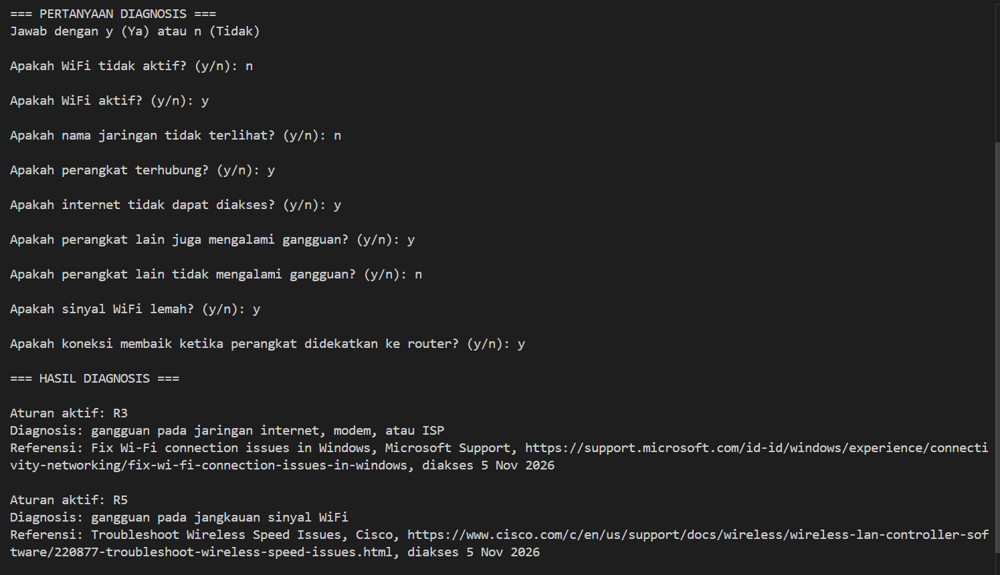
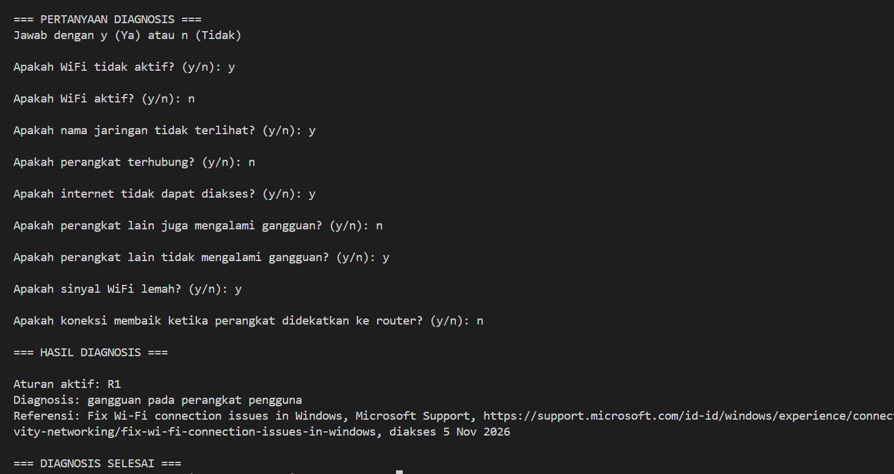
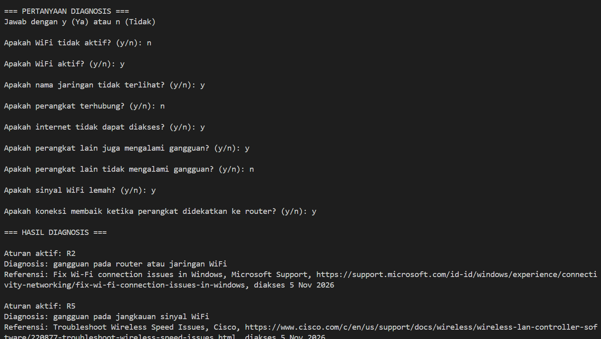

# Sistem Pakar Diagnosis Gangguan WiFi dan Internet

## 1. Identitas

- **Nama:** Azalia Sakila
- **NIM:** F1D02510005

## 2. Topik dan Cara Menjalankan Program

### Topik

Program ini merupakan sistem pakar sederhana untuk mendiagnosis penyebab gangguan WiFi dan internet menggunakan metode **Forward Chaining**. Sistem bekerja dengan mengumpulkan fakta berdasarkan jawaban pengguna, kemudian mencocokkannya dengan aturan yang terdapat dalam basis pengetahuan (*knowledge base*) untuk menghasilkan diagnosis.

### Teknologi yang Digunakan

- Bahasa pemrograman: Python
- Versi: Python 3.12
- Basis pengetahuan: JSON (`kb_wifi.json`)
- Library: `json` (library bawaan Python)

### Cara Menjalankan Program

1. Pastikan Python sudah terinstal pada komputer.
2. Letakkan file `main.py` dan `kb_wifi.json` dalam satu folder.
3. Buka terminal pada folder tersebut.
4. Jalankan perintah berikut:

```bash
python main.py
```

5. Jawab setiap pertanyaan menggunakan:
   - `y` untuk Ya.
   - `n` untuk Tidak.
6. Setelah seluruh pertanyaan dijawab, sistem akan memeriksa fakta dan menampilkan hasil diagnosis beserta aturan dan referensi sumber yang digunakan.

## 3. Daftar Sumber dan Tabel Aturan

### Daftar Sumber

**S1.** Microsoft Support. *Fix Wi-Fi connection issues in Windows.*

URL: https://support.microsoft.com/id-id/windows/experience/connectivity-networking/fix-wi-fi-connection-issues-in-windows

Tanggal akses: 5 November 2026.

**S2.** Cisco. *Troubleshoot Wireless Speed Issues.*

URL: https://www.cisco.com/c/en/us/support/docs/wireless/wireless-lan-controller-software/220877-troubleshoot-wireless-speed-issues.html

Tanggal akses: 5 November 2026.

### Tabel Aturan (Rule Base)

| ID | Kondisi (IF) | Kesimpulan (THEN) | Sumber |
|---|---|---|---|
| R1 | WiFi tidak aktif | Gangguan pada perangkat pengguna | S1 |
| R2 | WiFi aktif AND nama jaringan tidak terlihat | Gangguan pada router atau jaringan WiFi | S1 |
| R3 | Perangkat terhubung AND internet tidak dapat diakses AND perangkat lain juga mengalami gangguan | Gangguan pada jaringan internet, modem, atau ISP | S1 |
| R4 | Perangkat terhubung AND internet tidak dapat diakses AND perangkat lain tidak mengalami gangguan | Gangguan pada perangkat pengguna | S1 |
| R5 | Sinyal WiFi lemah AND koneksi membaik ketika perangkat didekatkan ke router | Gangguan pada jangkauan sinyal WiFi | S2 |

**Keterangan:** Seluruh aturan menggunakan operator AND (dan), sehingga semua kondisi dalam satu aturan harus terpenuhi agar sistem dapat menghasilkan kesimpulan.

## 4. Metode yang Digunakan

Metode yang digunakan dalam program ini adalah **Forward Chaining (Pelacakan ke Depan)**.

Forward Chaining merupakan metode penalaran yang dimulai dari fakta-fakta yang diberikan pengguna, kemudian mencocokkannya dengan aturan yang tersedia dalam basis pengetahuan hingga menghasilkan suatu kesimpulan.

### Alasan Pemilihan Metode

Metode Forward Chaining dipilih karena proses diagnosis dimulai dari kondisi atau gejala yang dialami pengguna. Sistem mengumpulkan jawaban pengguna sebagai fakta, kemudian memeriksa aturan yang sesuai untuk menentukan kemungkinan penyebab gangguan WiFi dan internet.

### Langkah Kerja

1. Sistem membaca basis pengetahuan dari file `kb_wifi.json`.
2. Sistem menampilkan sembilan pertanyaan diagnosis kepada pengguna.
3. Jawaban Ya (`y`) disimpan sebagai fakta.
4. Sistem memeriksa kondisi setiap aturan dalam basis pengetahuan.
5. Sistem menggunakan fungsi `all()` untuk memastikan seluruh kondisi pada aturan terpenuhi karena aturan menggunakan operator AND.
6. Jika aturan terpenuhi, sistem menampilkan ID aturan, hasil diagnosis, dan referensi sumber.
7. Jika tidak ada aturan yang terpenuhi, sistem menampilkan pesan bahwa diagnosis belum ditemukan.

### Contoh Perhitungan Manual

Contoh menggunakan aturan R3.

**Fakta yang diperoleh:**
- Perangkat terhubung = Ya.
- Internet tidak dapat diakses = Ya.
- Perangkat lain juga mengalami gangguan = Ya.

**Aturan R3:**

IF perangkat terhubung AND internet tidak dapat diakses AND perangkat lain juga mengalami gangguan.

THEN gangguan pada jaringan internet, modem, atau ISP.

**Perhitungan:**

- Kondisi 1 = True
- Kondisi 2 = True
- Kondisi 3 = True

```text
True AND True AND True = True
```

Karena seluruh kondisi terpenuhi, aturan R3 aktif dan sistem menghasilkan kesimpulan berupa gangguan pada jaringan internet, modem, atau ISP.

## 5. Pengujian Program

Pengujian dilakukan menggunakan empat kasus untuk memastikan sistem dapat mencocokkan fakta dengan aturan yang tersedia dalam basis pengetahuan. Pengujian mencakup tiga kasus yang menghasilkan kesimpulan dan satu kasus yang tidak menghasilkan kesimpulan.

### Kasus 1: Gangguan Jaringan Internet, Modem, atau ISP (R3)

**Input:**
- Perangkat terhubung = Ya.
- Internet tidak dapat diakses = Ya.
- Perangkat lain juga mengalami gangguan = Ya.
- Kondisi lainnya = Tidak.

**Hasil:**
- Aturan aktif: R3.
- Diagnosis: Gangguan pada jaringan internet, modem, atau ISP.

**Screenshot hasil pengujian:**



### Kasus 2: Gangguan pada Perangkat Pengguna (R4)

**Input:**
- Perangkat terhubung = Ya.
- Internet tidak dapat diakses = Ya.
- Perangkat lain tidak mengalami gangguan = Ya.
- Kondisi lainnya = Tidak.

**Hasil:**
- Aturan aktif: R4.
- Diagnosis: Gangguan pada perangkat pengguna.

**Screenshot hasil pengujian:**



### Kasus 3: Gangguan pada Router atau Jaringan WiFi (R2)

**Input:**
- WiFi aktif = Ya.
- Nama jaringan tidak terlihat = Ya.
- Kondisi lainnya = Tidak.

**Hasil:**
- Aturan aktif: R2.
- Diagnosis: Gangguan pada router atau jaringan WiFi.

**Screenshot hasil pengujian:**



### Kasus 4: Tidak Ditemukan Diagnosis

**Input:**
- Seluruh pertanyaan dijawab Tidak (`n`).

**Hasil:**
- Tidak ada aturan yang terpenuhi.
- Sistem menampilkan pesan: "Belum ditemukan diagnosis yang sesuai."

**Screenshot hasil pengujian:**


## 6. Batas Keberlakuan Sistem

Sistem pakar ini menggunakan pengetahuan yang bersumber dari dokumentasi Microsoft Support dan Cisco. Diagnosis yang diberikan hanya mencakup kondisi WiFi tidak aktif, nama jaringan tidak terlihat, kegagalan koneksi, gangguan akses internet, gangguan pada perangkat lain, serta sinyal WiFi lemah. Sistem ditujukan sebagai alat bantu diagnosis awal berdasarkan jawaban pengguna dan aturan yang tersedia, bukan sebagai pengganti pemeriksaan teknis secara langsung. Oleh karena itu, hasil diagnosis merupakan saran awal dan bukan keputusan akhir dalam menentukan penyebab gangguan.

## 7. Penggunaan Alat Bantu AI

Dalam pengerjaan tugas ini, alat bantu AI (ChatGPT) digunakan untuk membantu penyusunan dokumentasi README dan penjelasan metode Forward Chaining. Kode program dan basis pengetahuan disesuaikan dengan implementasi yang digunakan dalam tugas.
